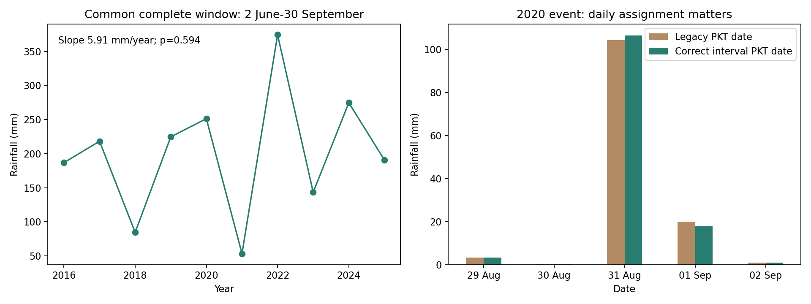
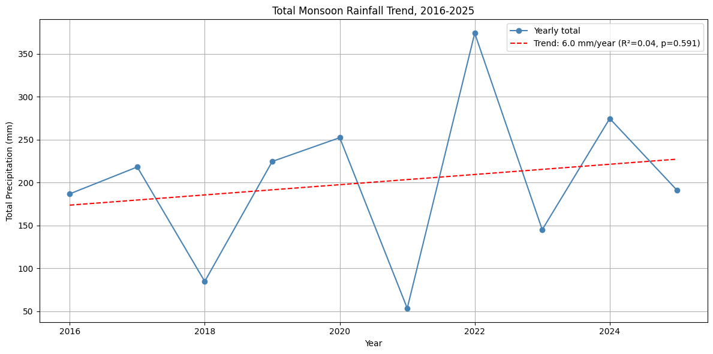
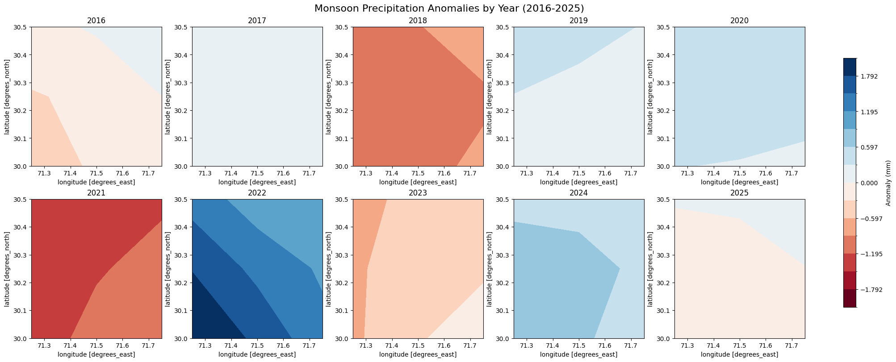
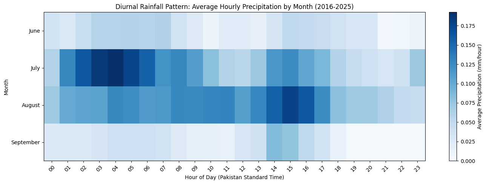
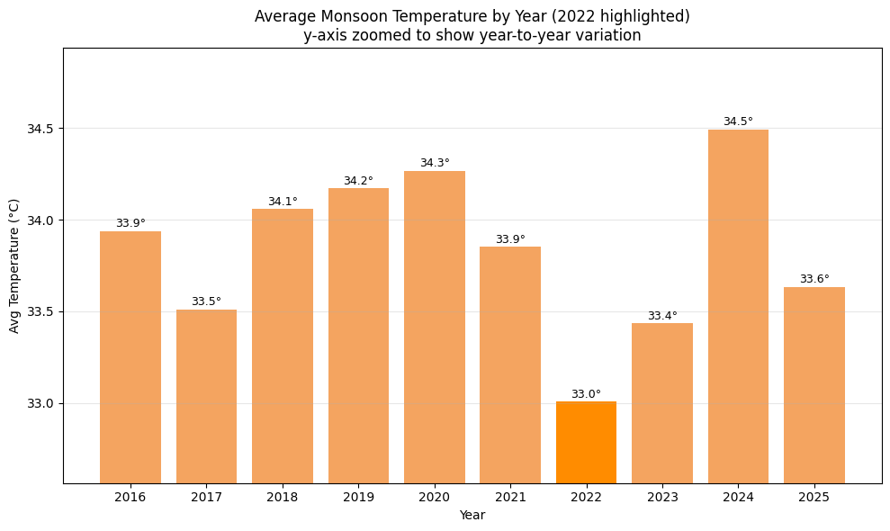
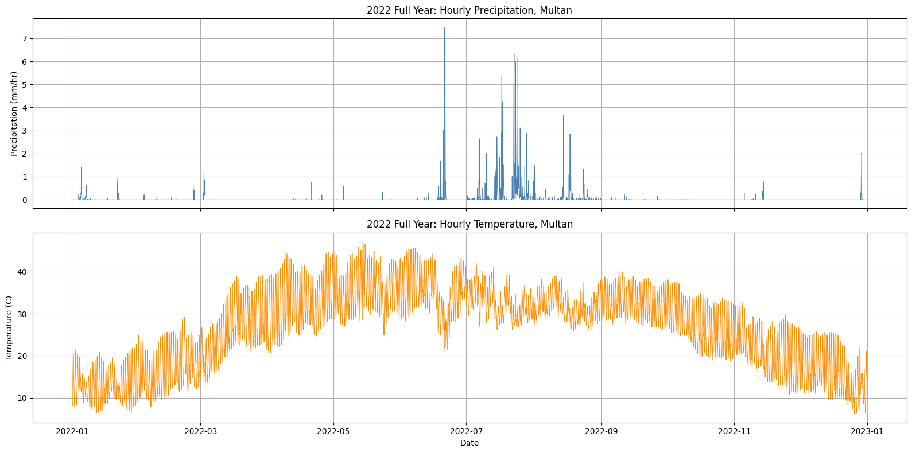

# Multan Monsoon Rainfall & Temperature Analysis (ERA5, 2016–2025)
**Reader guide:** [Project structure and report status](docs/PROJECT_GUIDE.md) · [Public portfolio](https://musab-shahid-earth-observation.brinycourt4.chatgpt.site/)

**ERA5 reanalysis · Python/xarray · Monsoon variability · Descriptive statistics · 2022 case study**

A **collaborative** analysis of monsoon rainfall and temperature in the Multan region, with a closer look at the 2022 season.

**Project lead and primary analyst:** Musab Shahid, who initiated the ERA5 practice project following a climate-modeling conference in Bahawalpur. [Contribution statement](docs/CONTRIBUTIONS.md).

**Original team:** Musab Shahid · Alishba Ehsan · Mudassir Mujahid · Bareera  
**Data:** ECMWF ERA5 hourly single-level reanalysis via the Copernicus Climate Data Store  
**Study region:** 30.0–30.5°N, 71.2–71.8°E (approximately 3×3 ERA5 grid points)  
**Period:** June–September 2016–2025, plus full-year 2022 context

> **Research scope:** Reanalysis-derived rainfall and temperature, **not** direct rain-gauge observations or a hydrological flood-routing simulation. A 10-year record is insufficient to establish a long-term climate trend.

## November 2026: executed reproducibility audit

All ten preserved hourly files were checked and historical daily/annual CSV results reproduced within numerical tolerances. The new analysis corrects rainfall interval assignment, excludes unobserved interseason days, and qualifies incomplete seasonal coverage. Six focused tests pass.

- **[Read the audit and corrections](docs/REPRODUCIBILITY_AUDIT.md)** · [Executed audit notebook](notebooks/ERA5_Reproducibility_Audit.ipynb) · [Corrected tables and input hashes](results/reproducibility/)
- The corrected 31 August 2020 PKT rainfall is **106.50 mm**, compared with the historical timestamp-grouped 104.29 mm.
- Nine files lack four initial PKT rainfall hours. Use the complete **2 June–30 September** comparison window: trend **+5.91 mm/year, p=0.594**, not statistically significant. Do not label partial observed sums as complete monsoon totals.
- The historical notebook source inserts 2,189 unobserved interseason days as zeros; the new script does not. See the audit for the percentile discrepancy between source and saved results.

## Explore the project

| Start here | What it contains |
| --- | --- |
| [Research figures](figures/) | Published seasonal rainfall, anomaly, temperature and hourly-pattern charts |
| [Analysis-only Colab notebook](notebooks/Multan_ERA5_Analysis_ONLY_NO_DOWNLOAD.ipynb) | Reusable calculations using existing NetCDF files; **no CDS re-download** |
| [Daily and annual CSVs](data/processed/) | Regional daily time series and 10-year seasonal summary |
| [Reproduction guide](docs/RUNNING.md) | Expected Drive inputs and environment notes |
| [Original research report](docs/original_analysis_report.pdf) | Preserved research narrative |
| [Final poster](docs/final_poster.pdf) | Poster-format visual summary |
| [2020 UTC/PKT reconciliation](docs/METHODOLOGY_AND_RESULT_RECONCILIATION.md) | Why the two reported August 2020 daily maxima differ |
| [Original presentation (Drive)](https://docs.google.com/presentation/d/1gorhCmLKybStK6BY5sCedjADk4B45ZSu/edit) | Archived classroom presentation; source material, not the primary reproducibility artifact |

## Research questions

How variable were monsoon rainfall totals over 2016–2025? Is the fitted trend statistically meaningful? How did 2022 differ in seasonal total, daily intensity, heavy-rain frequency and temperature?

## Historical findings (preserved; read the audit amendment)

| Indicator | Result | Interpretation |
| --- | ---: | --- |
| Highest monsoon total | **374.2 mm — 2022** | Wettest selected season |
| Lowest monsoon total | **53.4 mm — 2021** | Driest selected season |
| Linear rainfall trend | **+5.96 mm/year; p = 0.591** | **Not statistically significant** |
| Mean 2022 monsoon temperature | **33.0°C** | About 0.9°C cooler than the other nine-year mean |
| Wettest day by Pakistan calendar | **104.29 mm — 31 Aug 2020** | Local-date daily aggregation |
| Wettest day in separate UTC analysis | **110.91 mm — 31 Aug 2020** | Different 24-hour boundary; not the same statistic |

## Evidence in figures

| Rainfall anomalies | Diurnal pattern |
| --- | --- |
|  |  |

| Monsoon temperature | Full-year 2022 context |
| --- | --- |
|  |  |

See the [full figures gallery](figures/).

## Analysis and reproducibility

The notebook reads the original hourly **NetCDF** files kept in Google Drive, averages the small ERA5 spatial grid, converts precipitation from metres to millimetres and temperature from Kelvin to Celsius, and aggregates by calendar date after a UTC→Pakistan-time conversion. It computes seasonal totals, wettest days, >10 mm daily rainfall counts, dry spells, regression and visualizations.

**Important timing qualification:** ERA5 hourly precipitation is accumulated over the preceding hour. A day boundary based on the hour-ending timestamp can shift an accumulation at midnight to the next calendar day. This affects daily extremes; the completed [hourly-source audit](docs/REPRODUCIBILITY_AUDIT.md) now provides revised values. The local/UTC window difference is separately explained in the [methodology note](docs/METHODOLOGY_AND_RESULT_RECONCILIATION.md).

- Daily and annual processed summaries were rechecked against the published CSVs: totals, wettest-day records, heavy-rain counts and longest dry spells match to reported precision.
- An independent numerical reproduction from all ten preserved NetCDF files has now completed. The audit records package versions and input hashes. This does not certify a newly provisioned environment or an independent CDS download.
- Raw GRIB/NetCDF data are in the [research archive on Drive](https://drive.google.com/drive/folders/1-VWthMW-y28WWE5xLciciaOSFqXTT3I_), not GitHub. [Data provenance](data/README.md) documents the outputs.
- 2022 rainfall extremes do not establish causation of observed flooding; there is no terrain, streamflow, drainage or inundation model here.
- Original team credits are retained; Musab's leadership and primary analysis role are documented from his account in [Contributions](docs/CONTRIBUTIONS.md).

## Research portfolio

[Fourth project: Multan Environmental Heat Screening](https://github.com/musab-shahid/multan-environmental-heat-screening) adds source-ID mapping and temporal model evaluation.

| Project | Focus | Research context |
| --- | --- | --- |
| [Multan Urban Heat Analysis](https://github.com/musab-shahid/multan-uhi-analysis) | Landsat thermal remote sensing and spatial grouping | Undergraduate final-year project |
| **This project — ERA5 Monsoon** | Reanalysis time series, seasonal rainfall and statistical inference | **Collaborative**, four contributors |
| [South Punjab Drought Analysis](https://github.com/musab-shahid/south-punjab-drought-analysis) | Multi-sensor drought monitoring and environmental response | **Independent** research-application report |

**Data credit:** Copernicus Climate Change Service, ECMWF ERA5, accessed through the [Copernicus Climate Data Store](https://cds.climate.copernicus.eu/). Respect upstream data licensing and attribution.
