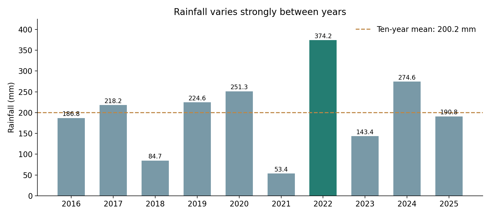
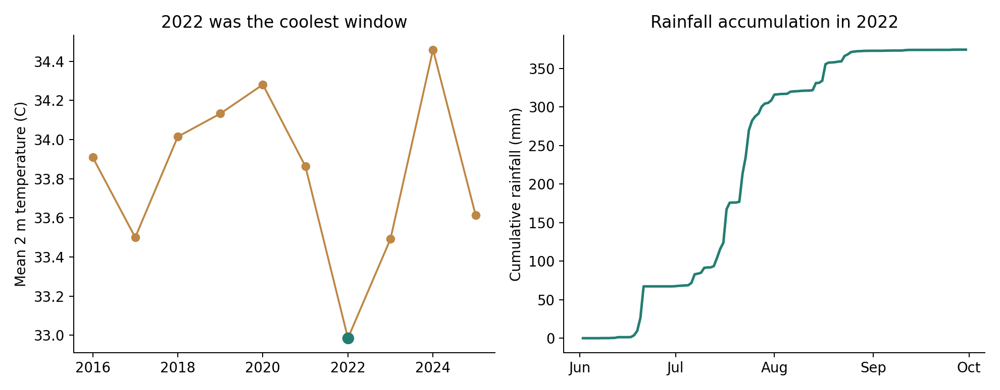

# Monsoon Rainfall & Flood-Risk Analysis for Multan

*Using ERA5 Reanalysis Data*

Final research report | 8 November 2026

### Overview

This study describes interannual rainfall and near-surface temperature variability over a small ERA5 grid around Multan. It compares the same 121 Pakistan-calendar days, 2 June to 30 September, in each year from 2016 through 2025. The objective is to characterize variability and the distinctive 2022 season, rather than attribute flooding or establish a long-term climate trend.

### Key findings

Rainfall ranged from 53.4 mm in 2021 to 374.2 mm in 2022. The ten-year mean was 200.2 mm. The fitted slope was +5.91 mm/year (p = 0.594), which does not establish a statistically significant linear trend. In the common window, 2022 was also the coolest year, with a mean 2 m temperature of 32.99 C.

### Project context

Project lead and primary analyst: Musab Shahid. Musab initiated this ERA5 practice project following a climate-modeling conference in Bahawalpur. Original team: Musab Shahid, Alishba Ehsan, Mudassir Mujahid and Bareera. The contribution statement records the leadership account supplied by Musab.

## Data and methods

### Input data

Ten preserved ERA5 hourly single-level NetCDF files provide total precipitation and 2 m air temperature. The sampled coordinates are 30.00, 30.25 and 30.50 degrees N, and 71.25, 71.50 and 71.75 degrees E: nine grid points. This is a small regional sample around Multan, not an administrative-boundary average. The data source is ECMWF/Copernicus Climate Change Service, accessed originally through the Climate Data Store.

### Spatial and temporal aggregation

Each hourly field is averaged equally across the nine grid points. Precipitation is converted from metres to millimetres; temperature from kelvin to Celsius. ERA5 hourly precipitation describes the preceding hour, so its interval is assigned to the Pakistan date using timestamp + 5 hours - 1 hour. Instantaneous temperature uses timestamp + 5 hours. Daily rainfall is the sum of 24 hourly intervals and daily temperature the mean of 24 hourly samples.

### Comparison period

All final cross-year metrics use 2 June-30 September (121 days; 1,210 daily records across ten years). The nine seasonal files begin at 1 June 00:00 UTC; their first Pakistan rainfall day lacks four preceding intervals. The full-year 2022 file does not have this boundary issue. Excluding 1 June consistently yields complete rainfall and temperature coverage in every year, without estimating or zero-filling missing hours. These totals should not be relabeled as full 1 June-30 September totals.

### Statistics

Rainfall totals, mean temperature, the wettest daily amount and counts of days above 10 mm are calculated within the common window. The 10 mm threshold is an operational definition for this analysis, not a local warning criterion. A simple ordinary least-squares regression relates the ten rainfall totals to calendar year. Its two-sided slope p-value is descriptive; ten annual samples provide limited evidence for climate-trend inference.

| Year | Rainfall (mm) | Temperature (C) | Days >10 mm |

| --- | ---: | ---: | ---: |

| 2016 | 186.81 | 33.91 | 5 |

| 2017 | 218.16 | 33.50 | 7 |

| 2018 | 84.67 | 34.01 | 0 |

| 2019 | 224.62 | 34.13 | 8 |

| 2020 | 251.28 | 34.28 | 5 |

| 2021 | 53.37 | 33.86 | 0 |

| 2022 | 374.21 | 32.99 | 11 |

| 2023 | 143.35 | 33.49 | 4 |

| 2024 | 274.64 | 34.46 | 8 |

| 2025 | 190.79 | 33.61 | 7 |

## Results and interpretation

### The 2022 season

The 2022 window accumulated 374.2 mm, 106.9% above the mean of the other nine windows. It had 11 days above 10 mm. Its wettest day was 17 July (43.44 mm). Mean temperature was 0.93 C below the other nine-year mean. These co-occurring wet and cool conditions are descriptive associations; the analysis does not isolate their physical causes.

### Variability and daily concentration

The wettest individual day across the comparison windows was 31 August 2020, with a regional mean of 106.50 mm. Thus the year containing the largest single-day amount was not the year with the largest window total. Seasonal accumulation and daily intensity describe different aspects of rainfall. The 2021 window was driest at 53.4 mm, while 2024 ranked second wettest at 274.6 mm.

### Trend interpretation

The fitted rainfall slope is +5.91 mm/year, with p = 0.594 and R-squared = 0.037. Large year-to-year variation dominates this short record. A nonsignificant result is not proof that rainfall is unchanging; it means this analysis does not establish a linear change over the selected ten years.

## Scope, reproducibility and sources

### Conclusion

The completed analysis documents substantial interannual variability in the selected Multan ERA5 grid. The 2022 comparison window was wettest and coolest, whereas the largest daily rainfall amount occurred in 2020. The ten-year rainfall regression is not statistically significant. These findings support a clear descriptive case study of reanalysis handling, time aggregation and environmental data interpretation.

### Scope and limitations

Results apply to a nine-point reanalysis grid and the stated 121-day window. They are not station measurements, ward-level estimates, an inundation model or an attribution of the 2022 floods. Equal grid-point averaging preserves the original regional calculation. This release does not claim validation against local rain gauges. Such comparison, a longer record or retrieving the excluded boundary hours would be optional extensions beyond this completed scope.

### Reproduce the release

The repository provides the analysis code, executed notebook, final daily and annual CSVs, figures, package versions, and input hashes. Run src/reproduce_monsoon.py against the preserved hourly files, then src/build_research_release.py to rebuild the final tables and figures. Six focused tests check daily assignment and missing-data handling. The supporting audit records agreement with historical results and explains revisions. The historical report, poster and original tables remain available as archive materials; use this report and results/final for the current findings.

### Authorship and assistance

Musab Shahid led the original work and analysis, with original team membership credited on page 1. The November 2026 reproduction, release code and report preparation used AI assistance. Team membership is not a claim that every participant reviewed this later release. Report release: 8 November 2026.

### Sources and materials

Data: Copernicus Climate Change Service / ECMWF, ERA5 hourly data on single levels, Climate Data Store: https://cds.climate.copernicus.eu/ . Accumulation convention: ECMWF ERA5 data documentation, section on mean rates and accumulations. Project repository: https://github.com/musab-shahid/multan-era5-monsoon-analysis . Full technical provenance and the documentation link are in docs/REPRODUCIBILITY_AUDIT.md.
